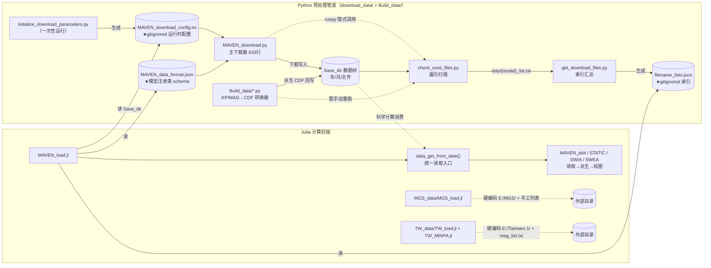
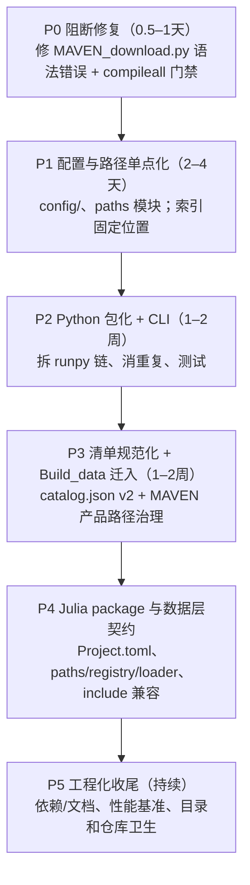

# 《项目重构诊断与迁移评估报告》

## 下一步执行提示词

```text
请依据本报告实施重构的 P0 阶段，不要只给计划或重复诊断。开始前先阅读本报告、检查相关源文件和当前 git 工作区状态；保留已有用户修改。只处理 P0，不自动继续 P1 或后续阶段。

本阶段范围：
1. 修复 download_data/MAVEN_download.py 的语法错误，并按 D1 保留文件完整性检查能力，将其整理为可单独调用的检查入口；检查默认只报告结果，删除、隔离或修复文件必须显式启用。
2. 修复 check_download_file 配置项与初始化器之间的契约缺口，确保新生成的配置可被下载器读取。
3. 将扫描和索引更新整理为显式可调用流程，修复下载完成后扫描脚本主流程未执行的问题；不要依赖会跳过 __main__ 分支的 runpy 调用。
4. 为上述行为添加最小化测试或临时目录验证，覆盖配置初始化、扫描、索引生成及下载后的索引刷新。

必须遵守的数据约束：
- 所有 MAVEN 产品继续共用现有 MAVEN 数据根，并保留 MAVEN/仪器/处理级别/yyyy/mm/文件目录格式，例如 MAG/l2、MAG/l3、KP/cdf。
- 原始与派生产品继续由现有产品 ID、路径和文件名正则区分；不得新增 derived_data_root，不得迁移、重命名或重新组织真实数据目录。
- TW 和 MGS 仍使用各自独立的数据根；本阶段不改这两类数据接口。
- 不进行真实网络下载，不对真实科学数据执行删除、覆盖或批量操作；测试仅使用临时目录和合成文件。

实施与交付要求：
- 只做支持 P0 验收所需的最小代码改动，不做 Python/Julia 包化、全目录搬迁或无关清理。
- 修改前提出一个可证伪的本地假设和一个最便宜的验证；修改后先运行针对性验证，再扩展检查。
- 最终运行全仓 Python AST/语法检查及相关测试；说明执行的命令、结果、未能验证的部分和改动文件。
- P0 验收后停止，汇报结果与 P1 前置条件，不擅自开始下一阶段。
```

> **报告对象**：`Julia_for_MartianSpaceData`（火星空间数据处理与科学计算工具包）
> **生成日期**：2026-10-12
> **扫描范围**：工作区全部 11 个 Python 文件（约 2,710 行）+ 30 个 Julia 文件（约 12,453 行）+ 3 个 JSON 契约文件 + 配置/文档
> **分析方法**：全量静态阅读 + AST 语法校验 + 调用链（`include`/`runpy`/JSON 读写）交叉核验
> **报告状态**：诊断稿评估修订版；源代码未做任何修改，本轮仅更新本报告

---

## ⚡ 关键发现速览（TL;DR）

| #  | 发现                                                                                                      | 严重度  | 证据位置                                                                        | 人工注释                                                               |
| -- | --------------------------------------------------------------------------------------------------------- | ------- | ------------------------------------------------------------------------------- | ---------------------------------------------------------------------- |
| 1  | **主下载脚本存在语法错误，当前无法运行**：`file_check` 函数体缩进溢出                             | 🔴 阻断 | `download_data/MAVEN_download.py:343-345`（AST 校验 FAIL: unexpected indent） |                                                                        |
| 2  | `check_download_file` 配置项被读取，但初始化器从未生成该键 → 运行即 `NoOptionError`                  | 🔴 阻断 | `MAVEN_download.py:53` vs `initialize_download_parameters.py:39-47`         |                                                                        |
| 3  | 跨语言索引写入使用**CWD 相对路径**，运行目录不同则写入错误位置                                      | 🟠 高   | `get_download_files.py:25-28`                                                 | 可以考虑将产生的文件路径json文件放入下载目录中                         |
| 4  | 三大卫星任务数据接入方式**完全不对称**：MAVEN 走 JSON 索引，TW/MGS 走硬编码 `E:/` 路径 + 手工列表 | 🟠 高   | `TW_load.jl:10`、`MGS_load.jl:6`                                            | TW和MGS并未进行批量下载处理，此处接口保留为这种临时状态                |
| 5  | Julia 侧硬编码`D:/CODE/Package_for_Julia/` 包路径与 DLL 路径（仓库现运行于 macOS）                      | 🟠 高   | `common/head.jl:28`、`call_fortran_dll.jl:42`                               |                                                                        |
| 6  | 脚本间以`runpy` 隐式三级链式调用通信，不可独立测试                                                      | 🟡 中   | `MAVEN_download.py:630`、`check_exist_files.py:76`                          |                                                                        |
| 7  | 派生产品按现有 MAVEN 产品目录写入，构建后仍需刷新索引                                                     | 🟡 中   | `KP重构为cdf.py:817-824`、`磁场重构为CDF文件.py:371-378`                    | 沿用现有目录/命名；补可靠的索引刷新流程（当前 runpy 调用无效）          |
| 8  | 公共辅助函数在 Python 侧复制 3–5 份（无共享模块）                                                        | 🟡 中   | `get_list_from_ini` × 5 处、`download_model` × 3 处                       | 可以考虑将这些函数提出到common里                                       |
| 9  | 示例脚本 JLD2 缓存判断逻辑反转（`!isfile` 后执行 `load`）                                             | 🟡 中   | `MAVEN_overview_plot_sample.jl:574-575`                                       | 这里是示例文件，可以暂时不管                                           |
| 10 | `requirements.txt` 为全量 `pip freeze`（含 `pywin32`），跨平台安装即失败                            | 🟡 中   | `requirements.txt`                                                            | 重新整理一下目前包内python所需要的库，简单地做`requirements.txt`出来 |
| 11 | 下载结束后调用扫描脚本不会进入其主流程，清单不会按预期自动刷新                                            | 🟠 高   | `MAVEN_download.py:634`、`check_exist_files.py:61`                          | `runpy.run_path()` 默认 `__name__ == "<run_path>"`，主入口条件为假 |

---

## 一、全局工作流与数据链路诊断

### 1.1 全链路总览



**核心结论**：当前工作流的真实形态是 **“INI + JSON 双契约驱动 MAVEN 链路，硬编码路径驱动 TW/MGS 链路”**。Python 与 Julia 之间并不直接通信，而是通过三个共享文件解耦（这正是本项目的桥梁设计）：

| 桥梁文件                              | 生产者                                            | 消费者                                                   | 角色                                                               |
| ------------------------------------- | ------------------------------------------------- | -------------------------------------------------------- | ------------------------------------------------------------------ |
| `MAVEN_download_config.ini`         | `initialize_download_parameters.py`             | 全部 Python 脚本 +`MAVEN_load.jl` / `SP_load.jl`     | 运行时环境配置（`Save_dir` 等）                                  |
| `MAVEN_data/MAVEN_data_format.json` | **人工维护**                                | Python 下载器 +`MAVEN_load.jl`（构造 `read_models`） | **模型注册表**：URL 路径、文件名正则、本地子目录、加载函数名 |
| `MAVEN_data/filename_lists.json`    | `check_exist_files.py → get_download_files.py` | `MAVEN_load.jl`（构造 `filename_list`）              | 本地文件索引/清单                                                  |

### 1.2 Python 端逐环剖析

#### ① 配置生成环 — `initialize_download_parameters.py`（55 行）

- **逻辑**：用 `configparser` 硬编码全部默认值写出 INI，再把每行 `lstrip()` 后回写（用于清理内联注释的缩进）。
- **问题**：
  - 配置值内嵌中文注释（`"60 \n;下载错误时的休眠时间..."`），属于“值即注释”的 hack；任何一个换行/空格处理不当会污染配置值；
  - Windows 路径字符串触发 `SyntaxWarning: invalid escape sequence`（`C:\Program Files...`、`D:\software...`，见 AST 校验输出）；
  - **契约漂移**：`MAVEN_download.py:53` 读取的 `check_download_file` 键**不在生成清单中**，`Server_ind` 则以字符串键 `"0"/"1"/"2"` 指向 URL（`config_data['Servers'][Server_ind]` 用整数查询，依赖 `optionxform=str` 后的字符串化行为，脆弱）。

#### ② 下载环 — `MAVEN_download.py`（633 行，主流程最重）

- **逻辑**：读 INI + schema → `download_model()` 拼 URL/落盘路径/文件正则 → 按月遍历服务器目录树生成任务表 `download_heads.json` → 对比本地版本去旧 → 按 `download_mode`（`python.request` / `win.idm` / `Aria2c`）多线程下载 → 完成后 `runpy` 调 `check_exist_files.py`。
- **亮点（应保留）**：`requests_download` 的 `.pydownload` 临时文件 + 原子改名、429 限流自动休眠、Aria2c 的断点续传与 RAID5 保护参数、`download_heads.json` 断点续传记录——工程细节考虑周到。
- **问题**：
  - 🔴 **语法错误**：`file_check()`（L343）函数体统一缩进 8 空格，AST 解析直接失败——**整个脚本当前不可导入/运行**；且该函数在全仓无调用点，`check_download_file` 开关同样无消费者，说明“下载后完整性校验”功能处于半拆除状态；
  - `download_from_head` 中 `win.idm` 失败路径 `logic`/`time_now` 未绑定即使用（UnboundLocalError 隐患，L410-421）；
  - `models_skip` 硬编码清单按服务器分支重复两份（L57、L61），与 schema 的职责重叠；
  - `search_url` 的 `except` 分支可能引用未绑定的 `response`（L128-131）。

#### ③ 扫描环 — `check_exist_files.py`（78 行）

- **逻辑**：读 schema + INI → 各模型 `os.listdir` 三层遍历（年/月/文件）→ 正则过滤 → 写 `Save_dir/lists/{model}_list.txt` → `runpy` 调 `get_download_files.py` → `exit(0)`。
- **问题**：`MAVEN_data_format.json` 被重复加载两次（L17-25）；`search_downloaded_files` 假设目录结构恒为“年/月/（文件）”，对 TW/MGS/支持数据目录不适用（人工注释：TW和MGS并不以此格式保存，其相关处理程序完成度较低，此问题不用考虑）；`runpy` + `exit(0)` 使该脚本无法被安全 import。

#### ④ 索引环 — `get_download_files.py`（33 行）

- **逻辑**：扫 `Save_dir/lists/*.txt` → `model = listname[:-9]` 切片取模型名 → 汇总为 `{model: [相对路径...]}` 写 JSON。
- **问题**：
  - 🟠 **CWD 依赖**：输出路径 `"MAVEN_data/filename_lists.json"` 为相对路径，且 `Path(...).touch()` 在目录不存在时直接报错——在 `download_data/` 或任意目录下运行会写错位置或失败；
  - `listname[:-9]` 是魔法切片（依赖 `_list.txt` 恰好 9 字符）；
  - 无 schema 版本号、无生成时间戳、无文件计数校验。

#### ⑤ 辅助/维护环

| 脚本                              | 职责                                              | 主要问题                                                                                                                                                                                                                  | 人工注释                                                                                                        |
| --------------------------------- | ------------------------------------------------- | ------------------------------------------------------------------------------------------------------------------------------------------------------------------------------------------------------------------------- | --------------------------------------------------------------------------------------------------------------- |
| `clean_files.py`                | 清理`.aria2download` / `_compressed.cdf` 残余 | 路径来自 INI，较规范；重复定义`get_list_from_ini`（未使用）                                                                                                                                                             | 重复定义函数可以删除                                                                                            |
| `compress_cdf.py`               | 就地 GZIP 压缩大型 CDF                            | `raise e` 之后的“残留清理”代码不可达（L155-159）；阈值注释与调用参数不一致（100MB 注释 vs 250MB 实参）                                                                                                                | 建议在`raise e`后清理临时文件                                                                                 |
| `移除重复文件中的低版本文件.py` | 按`(v, r)` 版本排序删除旧文件                   | 中文文件名；`dry_run` 默认值良好但 `__main__` 中直接以 `False` 运行（危险默认被旁路）；`download_model` 重复实现                                                                                                  |                                                                                                                 |
| `download_files.py`             | 独立递归下载器（NAIF SPICE 内核）                 | 与配置系统**完全脱耦**：`save_path = r"C:\data\misc\spice\..."`、`url_path_root` 硬编码（L41-56）；`Server_ind = 1` 在读取配置后又被强制覆盖（L36-37，疑似调试残留）；`except` 分支 `response` 未绑定风险 | 此程序是一个基本的遍历爬虫程序，用于适配临时下载情况。save_path为临时路径，可以保留，但是请在注释里说明具体情况 |

#### ⑥ 数据加工环 — `MAVEN_data/Build_data/`（关键但易被忽视）

- **逻辑**：`KP重构为cdf.py`（823 行）、`磁场重构为CDF文件.py`（377 行）读取 INI + `filename_lists.json` + `KP_vars.json`，把官方文本数据（`.tab`/`.sts`）重建为带 GZIP 的本地 CDF（写入 `Save_dir/KP/cdf/`、`MAG/l3/`），随后**必须人工重跑 `check_exist_files.py`** 索引才能被 Julia 读到（`ngi整合.jl` 同理，见 `Build_data/ngi整合.jl:52-56` 手写 `lists/NGIMS_den_l4_list.txt`）。
- **问题**：派生产品与原始产品共用 MAVEN 数据根，但分别按产品注册信息写入 `MAVEN/仪器/处理级别/yyyy/mm/`；这是有意保持的统一目录格式，不应视为数据混杂或另建 `derived_data_root`。真正需要治理的是 MAG 转换器用 `mode_save_dir[:-2]+"3"` 推导 L3 目录的脆弱字符串操作，以及构建完成后索引未可靠刷新的问题。产品标识、路径和文件正则已用于区分派生格式，文档应把现有命名/索引规则说明清楚；无需以物理分根或重复增加分类字段作为前提。

### 1.3 数据交接与桥梁的评估结论

现有桥梁设计的**方向是正确的**（单文件 schema 同时服务两个语言），但工程化程度不足：

1. **schema 的位置与命名**：`MAVEN_data/MAVEN_data_format.json` 混在数据读取目录中，却承担全项目注册表职责；字段格式为“位置元组”（`value[:3]`、`value[3]`、`value[4]` 魔法索引），语义靠 `"description"` 字符串自述，无版本号、无校验；
2. **索引与配置是“生成物”但没有生成物管理**：`filename_lists.json`、INI、`download_heads.json`、`download.log` 均在 `.gitignore` 中（这点正确），但生成时机、失败半途状态、跨机器重建流程没有文档化契约；
3. **交接面不对称**：TW/MGS 完全绕过了桥梁体系，是“工作流断裂带”；`support_data/support_data_load.jl` 依赖 `Save_dir` 下的 `support_datas/` 目录（同样绕过索引）；
4. **Julia 侧对桥的读取是“启动期一次性”的**：`MAVEN_load.jl` 在 `include` 时即读取 INI + 两个 JSON 并构造全局 `read_models`/`filename_list`（L26-31、L1452-1463），意味着**配置/索引更新必须重启 Julia 会话**，且任何文件缺失都会让整个模块加载失败。

### 1.4 Julia 端消费链路诊断

| 链路                    | 入口                              | 加载器                                                   | 输出字典风格                                                                                       | 路径来源                                                                                |
| ----------------------- | --------------------------------- | -------------------------------------------------------- | -------------------------------------------------------------------------------------------------- | --------------------------------------------------------------------------------------- |
| **MAVEN（主力）** | `MAVEN_load.data_get_from_date` | `read_models` 动态 `eval(Meta.parse(value[4]))` 分发 | `Dict{Symbol,Any}` + `:data_load_flag` ✅ 相对统一                                             | INI`Save_dir` + JSON 索引 ✅                                                          |
| **TW（天问）**    | `TW_load.read_list()` 手工列表  | `load_mag_2c_bydlm` 等                                 | `Dict{Symbol,Any}`，但键集自定（`:time` 与 `:epoch` 并存）                                   | 🔴`root_path = "E:/Tianwen-1/"` 硬编码（两处：`TW_load.jl:10`、`TW_MINPA.jl:10`） |
| **MGS**           | `MGS_load.read_list()` 手工列表 | `load_mag`                                             | 🔴 遗留风格`Dict("Vars" => [...])` + `"data staute"`（拼写错误），下游需 `data["Vars"]` 解包 | 🔴`root_path = "E:/MGS/"` 硬编码                                                      |

- **MAVEN 读取层内部**：`MAVEN_plot`（1553 行）、`MAVEN_STATIC`（1204 行）、`MAVEN_SWIA`（430 行）、`MAVEN_SWEA`（194 行）职责划分清晰、docstring 完整；`static_c6_mass_mean` 等派生函数已采用“输入 Dict → 输出新 Dict”的模式，**这是全项目最成熟的部分**；
- **模型层**：`models/` 与 `Magnetic_Model/` 模块化良好（`Pickup_ion.jl` 的 `get_3d_slip_data_from_ins_FOR_PICKUP` 已把 swi/sta/minpa 三种仪器输入统一为同一 NamedTuple——**“仪器适配器”模式已有雏形**）；
- **已知坏函数**：`TW_load.calculate_mag`（L121-129）与 `MGS_load.caculate_mag`（L109-116，函数名拼写错误）引用未定义全局 `data`，调用即 `UndefVarError`；`MAVEN_plot.sta_heatmap_test` 引用未定义 `x0/x_range/unique_elements`；
- **性能热点**：`SWEA_calc_shape_arr_mars_towrads` 等用 `findmin(x->abs(x-te[i]), tb)` 逐点 O(N) 线性扫描时间轴（`MAVEN_load.jl:1410-1412`）——而 `head.jl` 里已有二分实现 `find_time`，属“已有更优解未被复用”；
- **平台耦合**：`common/head.jl:28` 的 `Package_path = "D:/CODE/Package_for_Julia/"` 使 `head.jl`、`Pickup_ion.jl` 在当前 macOS 环境下不可直接运行；`call_fortran_dll.jl` 的 DLL 路径同样硬编码（且 `.dll` 在 `.gitignore` 中被排除）；`requirement.jl` 是“串行 Pkg.add 脚本”而非 `Project.toml`，环境不可复现。

### 1.5 痛点定级清单

**🔴 阻断级（必须先处理）**

1. `MAVEN_download.py` 语法错误（下载管道不可运行）；
2. `check_download_file` 配置键契约断裂；
3. CWD 相对路径造成的索引写入位置漂移。

**🟠 高（结构性风险）**

4. TW/MGS 硬编码路径 + 手工列表，与 MAVEN 索引体系不兼容；
5. Julia 侧 `Package_path`/DLL 路径硬编码，跨平台即失效；
6. `runpy` 隐式三连链 + `exit(0)`，任何一环都不可单独测试/复用；
7. 派生产品已按统一产品目录格式写入 MAVEN 数据根；当前问题是输出路径推导脆弱、构建后索引更新无自动化闭环，而非需要将派生数据移出 MAVEN 根。

**🟡 中（工程债）**

8. Python 公共函数复制 3–5 份、无包结构；
9. 输出字典/键名风格不统一（MGS "Vars" 元组、TW `:time`/`:epoch` 混用）；
10. 异常处理参差（不可达清理代码、未绑定变量隐患、`file_check` 半拆除）；
11. 示例脚本路径与缓存逻辑缺陷；`requirements.txt` 全量 freeze（含 `pywin32`）；
12. 中文文件名（`移除重复文件中的低版本文件.py`、`KP重构为cdf.py`、`磁场重构为CDF文件.py`、`ngi整合.jl`）与 `.DS_Store`、`MAVEN STATIC ... Comparison O+.png` 等杂项入库。

**🟢 低**

13. `requirement.jl` 脚本式装包、镜像 URL 硬编码；wiki 生成器（`build_read_me.py`）依赖特定标题字符串定位插入点；`.gitignore` 残留已不存在的路径（`load_data/`、`修改文件树.py` 等）。

### 1.6 值得保留的现有资产（重构的锚点，勿推倒重来）

- ✅ **JSON schema 注册表思想**：`MAVEN_data_format.json` 一表多用（下载正则 + 落盘路径 + Julia 函数名），是解耦基石；
- ✅ Julia 模块化成果：`constants.jl` 集中化、`MarsCommon.jl` 公共函数下沉、SVector 迁移已完成（`doc/svector_migration_report.md`、`CHANGELOG.md` 2026-10-12 可证）；
- ✅ 下载器工程细节（原子改名、断点续传、限流退避、Aria2c 参数）；
- ✅ `dry_run` 安全模式（dedupe 脚本）与“跳过已存在文件”的设计；
- ✅ 仪器输入统一化雏形（`FOR_PICKUP` 三模式适配）与“派生函数返回新 Dict”的纯函数风格。

---

## 二、目标结构设计（重构后的文件树）

### 2.1 设计原则

1. **配置单点化**：所有脚本/模块只通过 `paths.py` / `paths.jl`（或中性的 `env` 模块）解析路径；禁止在业务代码中出现盘符字面量；
2. **代码与数据分离**：仓库只存“代码 + schema + 模板 + 索引（可选）”，大数据统一置于 `data_root`（由配置/环境变量指向）；
3. **索引即契约**：索引文件带 `schema_version`、生成时间、相对路径规范；**读端双兼容、写端单版本**；
4. **Python 包化、Julia 目录化（渐进）**：Python 收敛为 `martian_pipeline` 包与 CLI；Julia 先收敛路径/注册表/加载器契约，再评估包化；
5. **接口层宽容、计算层严格**：数据交接继续用 `Dict{Symbol,Any}`（兼容现状、抗字段演进）；数值热路径提取为具体类型数组 + `SVector` 后运算（零分配对齐）；
6. **每阶段可回滚**：迁移不采用“一次性大爆炸”，按上→下游顺序分 6 个阶段推进（见第四章）。

### 2.2 目标目录树（建议稿）

```
Julia_for_MartianSpaceData/
├── Project.toml / Manifest.toml            # 【新】Julia 工程化，取代 requirement.jl 串脚本
├── README.md / README_EN.md / CHANGELOG.md
├── pyproject.toml                          # 【新】Python 包元数据（取代全量 requirements.txt）
│
├── config/                                 # 【新】唯一配置层
│   ├── settings.example.toml               #   模板入库；本地 copy 为 settings.toml（gitignore）
│   └── schema/
│       ├── data_model.json                 #   由 MAVEN_data_format.json 升级（三任务统一注册表）
│       └── kp_vars.json                    #   原 MAVEN_data/KP_vars.json
│
├── python/                                 # 【新】Python 包（可 `pip install -e .` / `python -m`）
│   └── martian_pipeline/
│       ├── __init__.py
│       ├── cli.py                          #   统一入口：download/scan/manifest/build/maintain
│       ├── config.py                       #   配置读取（INI→TOML 双读过渡期）
│       ├── paths.py                        #   路径解析唯一出处（取代逐脚本拼接）
│       ├── manifest.py                     #   索引读写/校验（get_download_files 的正规化）
│       ├── inventory.py                    #   文件扫描（check_exist_files 的正规化，纯函数版）
│       ├── downloader/
│       │   ├── base.py                     #   Downloader 协议
│       │   ├── requests_dl.py / aria2.py / idm.py
│       │   └── scheduler.py                #   任务表生成（download_heads 逻辑）
│       ├── sources/                        #   服务器适配（USTC/UCLA/LASP）
│       └── builders/                       #   派生数据构建（原 Build_data/*.py）
│           ├── kp_to_cdf.py
│           └── mag_to_cdf.py
│       └── maintenance/                    #   原 clean/compress/dedupe 三脚本
│
├── julia/                                  # 方案A：迁入统一 julia/ 根（方案B：保留原顶层，见 4.3-D4）
│   ├── MarsData.jl/                        #   或继续 include 式，但目录职责对齐如下
│   │   ├── src/
│   │   │   ├── core/    (constants, MarsCommon, function_coordinate, 通用工具)
│   │   │   ├── env/     (paths.jl, registry.jl)      # 路径解析 + 模型注册
│   │   │   ├── loaders/maven/  (load, plot, static, swia, swea)
│   │   │   ├── loaders/mgs/    (load)
│   │   │   └── loaders/tw/     (load, minpa)
│   │   │   └── models/  (pickup_ion, orbit, octree, dispersion, maxwellian, graham)
│   │   └── ext/         (fortran/ call_fortran_dll.jl, dll 装载定位)
│   └── scripts/                            #   一次性/运维脚本（不进包）
│       ├── build_vsc.jl / STATIC_VD.jl / STATIC_vfd_3d.jl / ngi_merge.jl
│       └── get_all_orbit.jl                #   从 download_data/ 迁出（Julia 脚本归 Julia）
│
├── example/  (MAVEN_plot_sample/ …)        #   示例：路径参数化，输出目录可配置
├── doc/      (wiki/, 报告)
└── (data_root)                             #   仓库外：MAVEN/仪器/处理级别/yyyy/mm；派生产品沿用同一层级
```

### 2.3 三层契约定义（迁移的核心产物，需人工评审后固化）

**① 配置契约（建议 `config/settings.toml`，双读过渡期保留 INI）**

```toml
[paths]
maven_data_root = "E:/MAVEN/"    # 各任务路径集中解析，不要求数据物理上位于同一磁盘
tw_data_root = "E:/Tianwen-1/"
mgs_data_root = "E:/MGS/"
[server]
index = 0                        # 替代 "Server_ind" 字符串键
urls = ["http://222.195.76.155:8000/MAVEN/", "...", "..."]
[download]
mode = "python.request"          # python.request | win.idm | Aria2c
threads = 5
continue = true
[window]
start = "2014-10-01"
end   = "2025-06-01"
```

> 备选：维持 INI（改动最小），但**必须**拆分为 `config/default.ini`（模板）+ 本地覆盖文件，且去除“值内嵌注释”hack。两种方案的取舍见决策点 D3。
> 人工审批：改动合理，可以做

**② 索引/清单契约（`manifest/catalog.json`，读端兼容旧 `filename_lists.json`）**

```json
{
  "schema_version": 2,
  "generated_at": "2026-10-12T12:00:00Z",
  "products": {
    "MAG_pc1s": { "root_key": "maven", "product_path": "MAG/l2/", "pattern": "...", "files": ["2014/10/mvn_....sts"], "count": 1 },
    "MAG_pc1s_cdf": { "root_key": "maven", "product_path": "MAG/l3/", "pattern": "...", "files": ["2014/10/mvn_....cdf"], "count": 1 },
    "KP_cdf": { "root_key": "maven", "product_path": "KP/cdf/", "pattern": "...", "files": ["2014/10/mvn_....cdf"], "count": 1 }
  }
}
```

人工批注（采纳）：所有 MAVEN 产品（原始和派生）使用同一个 `maven_data_root`，保持 `MAVEN/仪器/处理级别/yyyy/mm/文件` 结构。产品 ID、产品路径和匹配正则负责区分产品及其格式；派生标记/生成器信息不是必需字段，只有确有消费需求时才作为可选产品元数据。索引使用一个 `products` 映射，不设独立 `derived` 分区或派生物理根目录。

**③ Julia 加载器 I/O 契约（全任务统一）**

```
所有 loader:  load_xxx(path::String) -> Dict{Symbol,Any}
必备键（硬性）:
  :data_load_flag::Bool     # 错误策略需逐加载器定义，不强制吞掉所有异常
  :time::Vector{DateTime}   # 面向计算/公共 API 的规范时间键
  :filename::String
兼容期:
  :epoch                    # 仅作为旧调用兼容别名；CDF 原始 epoch 的解码在 CDF 适配层处理
仪器键（建议，按任务可选）:
  :B, :position, :energy, :theta, :phi, :diff_en_fluxes, :quat_mso, ...
适配层:
  MGS_load 的 "Vars" 元组 → 统一 Symbol 字典（一次性 shim，不改变磁盘数据）
```

人工批注（采纳）：公共加载器以 `:time::Vector{DateTime}` 为统一字段；CDF 文件里的 `Epoch`/`epoch` 是源格式变量，由 CDF 读取适配层识别并转换，不将原始 CDF 变量名误当作跨任务公共时间键。迁移期为依赖 `:epoch` 的现有 Julia 调用提供别名，待调用点迁完再决定移除。

---

## 三、详细迁移与重构计划表

### 3.1 文件调整清单

> 图例：🔴=阻断修复（不改行为）；🟠=结构迁移；🟡=整理优化；“保留”=位置不动仅内部治理。

| #  | 原路径                                                                   | 新路径（建议）                                                                       | 移动/改动原因                                                                                                                                                         | 级别   |
| -- | ------------------------------------------------------------------------ | ------------------------------------------------------------------------------------ | --------------------------------------------------------------------------------------------------------------------------------------------------------------------- | ------ |
| 1  | `download_data/MAVEN_download.py`                                      | `python/martian_pipeline/downloader/scheduler.py` + `cli.py`                     | 🔴 先原地修复语法错误；再拆分为任务表生成/下载执行/日志三部分                                                                                                         | 🔴→🟠 |
| 2  | `download_data/initialize_download_parameters.py`                      | `config/settings.example.toml` + `python/martian_pipeline/config.py`             | 从“写 INI 的脚本”转为“模板 + 配置读写库”                                                                                                                          | 🟠     |
| 3  | `download_data/check_exist_files.py`                                   | `python/martian_pipeline/inventory.py`                                             | 扫描逻辑纯函数化；去除`runpy`/`exit(0)`；供 CLI 调用                                                                                                              | 🟠     |
| 4  | `download_data/get_download_files.py`                                  | `python/martian_pipeline/manifest.py`                                              | 消除 CWD 相对路径；加版本号/时间戳；魔法切片改为显式后缀剥离                                                                                                          | 🔴→🟠 |
| 5  | `download_data/compress_cdf.py`                                        | `python/martian_pipeline/maintenance/compress_cdf.py`                              | 修`raise e` 后的不可达清理；统一阈值参数                                                                                                                            | 🟡     |
| 6  | `download_data/clean_files.py`                                         | `python/martian_pipeline/maintenance/clean.py`                                     | 去重复工具函数                                                                                                                                                        | 🟡     |
| 7  | `download_data/移除重复文件中的低版本文件.py`                          | `python/martian_pipeline/maintenance/dedupe_versions.py`（**ASCII 重命名**） | CLI/模块命名一致性；`__main__` 危险默认改为显式 `--apply`                                                                                                         | 🟡     |
| 8  | `download_data/download_files.py`                                      | `python/martian_pipeline/downloader/naif_fetcher.py`（或标记废弃归档）             | 与配置体系脱耦的独立下载器；`Server_ind=1` 强制覆盖为疑似残留                                                                                                       | 🟡     |
| 9  | `MAVEN_data/Build_data/KP重构为cdf.py`                                 | `python/martian_pipeline/builders/kp_to_cdf.py`                                    | 归入构建器目录；继续写入 MAVEN 根下注册的 `KP/cdf/yyyy/mm/` 产品路径                                                                                                 | 🟠     |
| 10 | `MAVEN_data/Build_data/磁场重构为CDF文件.py`                           | `python/martian_pipeline/builders/mag_to_cdf.py`                                   | 继续写入 MAVEN 根下注册的 `MAG/l3/yyyy/mm/`；按产品注册路径替代`mode_save_dir[:-2]+"3"` 字符串手术                                                                  | 🟠     |
| 11 | `MAVEN_data/build_read_me.py`                                          | `tools/docgen/gen_data_format_wiki.py`                                             | 明确这是文档生成器而非数据读取                                                                                                                                        | 🟡     |
| 12 | `MAVEN_data/MAVEN_data_format.json`                                    | `config/schema/data_model.json`                                                    | 升级为全项目注册表（加`schema_version`、字段命名化）                                                                                                                | 🟠     |
| 13 | `MAVEN_data/KP_vars.json`                                              | `config/schema/kp_vars.json`                                                       | 与 schema 同居（人工批注：kp_vars.json可以考虑直接移除掉，现在的kp2cdf程序已经现式地描述了各个键值的区别，kp版本之间的区别我也做了校验，并不会改变每一列数据的类型）  | 🟡     |
| 14 | `download_data/get_all_orbit.jl`                                       | `julia/scripts/get_all_orbit.jl`（或并入 `scripts/`）                            | Julia 脚本不留在 Python 目录；输出的`orbit_time_range.txt` 路径参数化                                                                                               | 🟡     |
| 15 | `common/head.jl`                                                       | `julia/MarsData/src/core/head.jl`                                                  | 删除`Package_path="D:/..."`；include 列表改为 `env/paths.jl` 解析                                                                                                 | 🟠     |
| 16 | `common/constants.jl` / `MarsCommon.jl` / `function_coordinate.jl` | `julia/MarsData/src/core/`                                                         | 已治理良好，仅目录对齐                                                                                                                                                | 🟢     |
| 17 | `MAVEN_load.jl`（读 INI/JSON 的 26-31 行、1452-1463 行）               | `julia/MarsData/src/env/registry.jl` + loaders                                     | 注册表逻辑独立；`eval(Meta.parse)` 改为**显式注册 + 启动期校验**（找不到函数立即报“哪个模型的哪个函数名”）                                                  | 🟠     |
| 18 | `MGS_data/MGS_load.jl`                                                 | `julia/MarsData/src/loaders/mgs/load.jl`                                           | `root_path` 改由 env 注入；输出字典加统一 shim（`:time`）                                                                                                         | 🟠     |
| 19 | `TW_data/TW_load.jl` + `TW_MINPA.jl`                                 | `julia/MarsData/src/loaders/tw/`                                                   | 双处硬编码`E:/Tianwen-1/` 收敛为单点；公共时间键统一为`:time`，保留`:epoch`兼容期                                                                               | 🟠     |
| 20 | `call_fortran_dll.jl`                                                  | `julia/MarsData/ext/fortran/call_fortran_dll.jl`                                   | DLL 路径改为“环境变量/配置 + 探测”；补 macOS`.dylib` 支持评估（人工批注：不需要做macOS的补足处理，dll文件是windows系统编译的，mac端更多地作为远程端而不是计算端） | 🟠     |
| 21 | `models/*.jl`、`calculate/`、`Magnetic_Model/`                     | `julia/MarsData/src/models/` 等                                                    | 基本就地，修`calculate_mag` 等已知坏函数                                                                                                                            | 🟢     |
| 22 | `requirement.jl`                                                       | `Project.toml` + `Manifest.toml`                                                 | 环境可复现；`Pkg_list` 转为 `[deps]`                                                                                                                              | 🟠     |
| 23 | `example/MAVEN_plot_sample/*.jl`                                       | 保留，参数化                                                                         | 修`!isfile` 反转 bug（L574）；输出目录改配置项（`E:/MAVEN/MAVEN_plot/...`→ `results_dir`）                                                                     | 🟡     |
| 24 | `MAVEN_data/*.png`、`.DS_Store`、`doc/chat_session_raw.jsonl` 等   | 移入`doc/assets/` 或 gitignore                                                     | 仓库卫生（人工批注：`.DS_Store`为macOS产生的零碎文件，直接放入gitignore即可）                                                                                       | 🟢     |

### 3.2 Python 模块重构与接口规范化建议

1. **包化与 CLI**：`python -m martian_pipeline download|scan|manifest|build|clean|compress|dedupe`——每个子命令可独立运行、可组合；`runpy` 链替换为函数调用（`download → inventory.scan() → manifest.write()` 显式编排）；
2. **共享库收敛**：`get_list_from_ini`、`download_model`、`search_downloaded_files` 统一进 `config.py`/`inventory.py`，删除 5 处/3 处/3 处副本；
3. **异常与状态返回规范化**：下载/构建函数统一返回 `(status, payload)` 或小 dataclass（保持与现状的 JSON 日志兼容）；所有“删除类”操作默认 `dry_run=True`，需显式 `--apply`；
4. **索引读写单点**：`manifest.py` 唯一负责 `catalog.json` 的写与校验；旧 `filename_lists.json` 由 shim 读取（过渡期），确保 Julia 侧零改动即可工作；
5. **构建器自注册**：`builders/` 中每个转换器声明输入产品和输出产品 ID；输出路径复用注册表中的产品目录及 `yyyy/mm` 规则，`manifest` 更新同一个 `products` 清单，不额外建立 `derived` 分区或物理根目录。

### 3.3 Julia 任务模块 Input/Output Dict 与零分配对齐

> 目标：**不做全仓推倒**，而是把“已存在的优秀模式”固化为规范。

1. **I/O 契约固定**（见 2.3-③）：`data_get_from_date` 保持“日期 → `Dict{String, Dict{Symbol,Any}}`”的顶层接口；TW/MGS 各自收敛到 `load_*` 单入口并补齐 `:data_load_flag`/`:epoch`/`:filename`；
2. **边界适配（Adapter）分层**：
   - 接口层：`Dict{Symbol,Any}`（宽容，允许仪器字段差异）→ 与现状兼容；
   - 计算层：进入热循环前一次性提取 `Vector{Float64}`/`Matrix{Float64}` + 用 `@inbounds`、预计算、`SVector`；**禁止**在逐点循环中反复 `dict[:key]` 动态索引（当前 `SWEA_calc_shape_arr_mars_towrads` 等已是“先取局部变量再循环”的好写法，应推广到全部派生函数）；
3. **零分配对齐的具体清单**：
   - 将热路径中的 `findmin(x -> abs(x - t), tb)` 线性扫描替换为 `head.jl:find_time` 二分（已有实现，**只差接入**）；
   - 派生量（速度、坐标旋转结果等）保持 `SVector{3}` 返回（迁移报告已确立标准）；
   - `eflux_to_df!`、`static_c6_mass_mean` 等采用“预分配输出 + 就地写入”模式；
4. **注册表防错**：`registry.jl` 启动时对 `data_model` 逐项校验（函数在模块中可解析、正则可编译、路径键齐全），校验失败给出精确错误行，替代当前“运行到读取时才 `eval` 报错”；
5. **已知坏函数处置**：`TW_load.calculate_mag`、`MGS_load.caculate_mag`、`MAVEN_plot.sta_heatmap_test` 三者列入“修复或删除”清单（建议修复为 `data` 入参版并补测试，或删除）。

### 3.4 配置与索引的“单一事实来源”落地

| 事项       | 现状                                             | 目标                                                                                         |
| ---------- | ------------------------------------------------ | -------------------------------------------------------------------------------------------- |
| 数据根路径 | 每脚本各自`Save_dir + 拼接`；TW/MGS 另有硬编码 | `paths.resolve_root(:maven/:tw/:mgs)`（Py/Julia），集中解析任务根；MAVEN 产品子目录由注册表提供 |
| 模型元数据 | schema 位置元组 + 魔法索引                       | 命名字段（`urls/pattern/subdir/loader/description`）+ 版本号                               |
| 配置修改   | 直接改运行时 INI（可能被再初始化覆盖）           | 模板 + 本地覆盖；初始化器加`--force` 才覆盖                                                |
| 索引更新   | 手动跑`check_exist_files.py` 或下载后隐式触发  | `manifest` 在 下载完成/构建完成 后由 CLI 显式触发；失败时不写半成品（临时文件 + 原子改名） |
| 校验       | 无                                               | 扫描后输出“新增/消失(疑似坏文件)/总数”三行摘要，进入日志                                   |

---

## 四、分阶段实施路线图与风险提示

### 4.1 路线图（按上下游顺序，每阶段独立可验收/可回滚）



| 阶段         | 任务要点                                                                                                                                                                                                                     | 验收标准                                                                                                                         | 回滚方式                           |
| ------------ | ---------------------------------------------------------------------------------------------------------------------------------------------------------------------------------------------------------------------------- | -------------------------------------------------------------------------------------------------------------------------------- | ---------------------------------- |
| **P0** | ① 修复`file_check`语法并按 D1 抽为独立检查入口；② 初始化器补`check_download_file`契约；③ 修复扫描调用主流程未执行；④ 全仓 Python AST 检查                                                                            | 全部`.py` 通过 AST 编译；下载器能生成任务表（可 `--dry-run` 不下载）；下载后扫描能刷新索引                                   | 单文件级回滚，无接口变化           |
| **P1** | ① 建`config/` + `paths.py`；② `get_download_files.py` 输出路径改为“脚本自身位置推导”；③ Julia 增 `env/paths.jl` 并让 `MAVEN_load.jl` 改经它读 INI（**行为不变**）                                       | 在任意 CWD 运行扫描/索引，产物落点一致；Julia 读取结果与旧版逐键 diff 为空                                                       | 保留旧脚本副本，双运行对比         |
| **P2** | ①`martian_pipeline` 包 + CLI 子命令；② 删除 `runpy`/`exit(0)`；③ 补最小测试（inventory 纯函数、manifest 读写、正则/路径推导）                                                                                       | CLI 全链路（scan→manifest→压缩→清理）在样例目录上通过；无脚本间进程副作用                                                     | 旧脚本保留至 P3 结束               |
| **P3** | ①`catalog.json v2`（版本号/时间戳/raw\|derived 分区）；② `Build_data` 两转换器迁入 `builders/` 并接入 CLI；③ 派生目录策略落地（决策门 D5）                                                                          | 转换器运行后索引自动刷新；`catalog.json` 校验器通过；旧 `filename_lists.json` 仍可被读取端消费                               | 输出保留旧格式副本（双写过渡）     |
| **P4** | ①`registry.jl`（显式注册 + 启动校验）；② TW/MGS loader 统一到 `:time`/`:data_load_flag` 契约（磁盘数据零改动）；③ `head.jl` 删 `Package_path`；④ 建立 Julia package 入口并保留 include 兼容；⑤ 示例脚本参数化 | `Pkg.instantiate` 成功；公共 package API 可在无本地数据/DLL 时加载；旧 include 示例仍可用；Windows 计算环境的 DLL 前置条件清楚 | 契约兼容层（shim）保留两个版本周期 |
| **P5** | ① 完成依赖兼容版本/Manifest 管理；②`docgen` 重建 wiki 表；③ 性能基准（`@time`/`@allocated` 记录热函数）；④ `.gitignore`/杂项清理；⑤ 按需迁移源文件目录                                                          | 环境安装可复现；wiki 表格与 schema 一致；性能调整有基线；目录移动后 package 与 include 测试通过                                  | 低优先级整理可单独搁置             |

### 4.2 风险矩阵与防范措施

| #  | 风险                                                               | 可能性 | 影响 | 防范措施                                                                                                                                                                                           |
| -- | ------------------------------------------------------------------ | ------ | ---- | -------------------------------------------------------------------------------------------------------------------------------------------------------------------------------------------------- |
| 1  | 修复`MAVEN_download.py` 时误解 `file_check` 意图（功能半拆除） | 高     | 中   | 立决策门**D1**：明确“恢复校验能力 / 永久移除”；先仅修缩进使其可编译，功能语义并行评审（人工标注：该函数用于修复下载出错可能导致的cdf数据受损，可以单独提出来，专门作为下载文件检查的功能） |
| 2  | 索引/配置路径迁移导致存量机器上的`filename_lists.json` 失配      | 中     | 高   | 读端双兼容（新位置 → 旧位置 → 报错并打印修复命令）；提供一次性迁移函数（人工标注：可行，但是请在合适的位置写明此函数，因为该项目已经装载到了多台机器上）                                         |
| 3  | INI→TOML 双语言同步期出现两套配置漂移                             | 中     | 中   | 明确“单一写端”：任一时刻只有一个文件是权威源；提供转换器与差异校验                                                                                                                               |
| 4  | Julia include 结构调整引发加载顺序/预编译问题                      | 中     | 中   | 保持 include 语义小步走（先 paths/registry 抽离，后目录移动）；每步跑一次样例日加载回归                                                                                                            |
| 5  | 派生 CDF 与下载并发写入同一产品目录导致半写文件                     | 低     | 高   | 沿用已有“临时文件 +`os.replace` 原子替换”模式；构建器依据独立产品 ID/正则和标准层级写入，必要时以产品级锁避免同一输出并发覆盖                                                   |
| 6  | 删除类工具（dedupe/clean/compress）误删科学数据                    | 低     | 极高 | `dry_run` 默认；`--apply` 二次确认；操作前输出对账清单；强烈建议先备份或校验哈希                                                                                                               |
| 7  | 中文文件名重命名为 ASCII 破坏 Git 历史/文档链接                    | 中     | 低   | `git mv` 保留历史；分批提交；同步更新 README/wiki 引用                                                                                                                                           |
| 8  | 跨平台（Windows→macOS）迁移中的编码/换行/大小写问题               | 中     | 中   | 统一`utf-8` 读写；`.gitattributes` 规范换行；CI 跑静态编译检查                                                                                                                                 |
| 9  | Julia 契约统一后，旧用户代码（`data["Vars"]` 风格）中断          | 中     | 中   | 过渡期保留 legacy shim 并在文档中标注废弃时间表                                                                                                                                                    |
| 10 | 缺少测试导致重构回归不可见                                         | 高     | 高   | P2 起建立“黄金样本”测试：固定样例文件 → 新旧实现输出逐键 diff                                                                                                                                   |

### 4.3 已定决策点（按人工批注落地）

| 编号         | 决策问题                                      | 备选项                                               | 倾向性建议（仅参考）                                                                                                                                                                                                          |
| ------------ | --------------------------------------------- | ---------------------------------------------------- | ----------------------------------------------------------------------------------------------------------------------------------------------------------------------------------------------------------------------------- |
| **D1** | `file_check` / `check_download_file` 去留 | A. 独立文件检查功能并纳入 CLI；B. 删除死代码与配置键 | **采用 A**（人工决定）：不要把校验耦合在下载热路径；独立提供检查命令，先报告无效项，删除/修复动作须显式确认。修复校验语法和缺失配置键属于 P0。                                                                          |
| **D2** | TW/MGS 数据根是否并入统一`data_root`        | A. 并入；B. 各任务独立路径配置                       | **采用 B**（人工决定）：分别配置 MAVEN、TW、MGS 根路径；路径解析集中管理不等于把数据物理合并。                                                                                                                          |
| **D3** | 配置格式                                      | A. 保留 INI；B. 迁移 TOML                            | **采用 B**（人工决定）：TOML 为目标格式，INI 只作为有期限的兼容输入；迁移期必须指定唯一权威配置，禁止两种格式同时可写。Python 最低版本需明确（`tomllib` 需要 Python 3.11；若支持更早版本须声明 `tomli` 兼容依赖）。 |
| **D4** | Julia 是否包化（`Project.toml` + `src/`） | A. 全包化；B. 保留 include + 目录整理                | **采用 A**（人工决定）：建立正式 Julia package；`export` 保持克制，以模块名限定公共 API。迁移时提供旧 `include` 入口/兼容包装，不要求第一步就搬动所有源文件。                                                       |
| **D5** | 派生产品的目录与索引方式 | A. 沿用 MAVEN 根及统一产品层级；B. 新建独立`derived/` 根 | **采用 A**（按最新人工决定）：不设置 `derived_data_root`。原始与派生产品均写入同一 MAVEN 根，按现有产品 ID、文件正则和 `MAVEN/仪器/处理级别/yyyy/mm/` 路径区分；如 `MAG/l2/`、`MAG/l3/`、`KP/cdf/`。索引仍为单一 `products` 映射，不另设 `derived` 分区。 |
| **D6** | 中文文件名是否改 ASCII                        | A. 改；B. 保留                                       | **采用 A**（人工决定）：可按 UTF-8 源文件执行 `git mv`，并同步文档/脚本引用；但这属于低优先级可维护性工作，不应以“UTF-8 文件名必然跨平台失败”作为理由，也不应阻挡功能迁移。                                         |

---

## 附录 A：证据索引（抽查用）

| 结论                   | 证据                                                                                                             |
| ---------------------- | ---------------------------------------------------------------------------------------------------------------- |
| 主下载器语法错误       | AST 校验：`FAIL ./download_data/MAVEN_download.py -> unexpected indent line 345`；源码 L343-346                |
| 配置键缺口             | `MAVEN_download.py:53` 读 `check_download_file`；`initialize_download_parameters.py:39-47` 无该键          |
| CWD 相对路径           | `get_download_files.py:25-28`                                                                                  |
| runpy 链               | `MAVEN_download.py:630`、`check_exist_files.py:74-76`                                                        |
| TW/MGS 硬编码          | `TW_load.jl:10`、`TW_MINPA.jl:10`、`MGS_load.jl:6`、`MGS_load.jl:134`                                    |
| Julia 硬编码包路径/DLL | `common/head.jl:28`、`call_fortran_dll.jl:42,57`、`models/Pickup_ion.jl:273`                               |
| 派生数据回写           | `KP重构为cdf.py:817-824`、`磁场重构为CDF文件.py:371-378`、`ngi整合.jl:52-56`                               |
| 输出字典风格不一       | `MGS_load.jl:83-87`（"Vars"/"data staute"）；`TW_load.jl:95-108`（`:time`+`:epoch` 并存）                |
| 已知坏函数             | `TW_load.jl:121-129`、`MGS_load.jl:109-116`、`MAVEN_plot.jl:81-84`（`sta_heatmap_test` 未定义变量注释）  |
| 示例缓存逻辑反转       | `MAVEN_overview_plot_sample.jl:573-575`                                                                        |
| 二分函数未被复用       | `head.jl:find_time`（二分） vs `MAVEN_load.jl:1410-1412`（`findmin` 线性扫描）                             |
| 平台耦合统计           | 全仓`[A-Z]:/` 匹配 40 处 / 19 文件                                                                             |
| 生成物 gitignore       | `.gitignore`（`MAVEN_data/filename_lists.json`、`MAVEN_download_config.ini`、`download_heads.json`）     |
| 依赖不可复现           | `requirement.jl`（串行 `Pkg.add`）、`requirements.txt`（含 `pywin32==306`）                              |
| AST 静态校验结果       | 11 个 Python 文件中 10 个 OK；`MAVEN_download.py` FAIL；`initialize_download_parameters.py` 2 条 escape 警告 |

---

### 报告结语

本项目已经完成了**科学计算层（Julia models/instruments）**的第一轮现代化（常量集中、公共函数下沉、SVector 迁移、文档注释补齐），这部分**不建议推倒重来**。真正的债务集中在 **“配置—索引—脚本衔接”** 这一横向层：它是多语言协作的关节，也是当前错误密度最高（含两个阻断级问题）的区域。

建议的推进姿态是：**先止血（P0）、再立契（P1–P3）、最后动骨（P4–P5）**，全程保持“旧格式读兼容、新格式单写、样例回归、删除类操作 dry-run”四条安全线。D1–D6 已按人工批注作出选择；实施时以第五章的兼容要求和验收门槛为准，先从 P0 开始。

## 五、重构方案评估与修订结论

### 5.1 总体判断

**结论：重构方向成立，但原路线图不宜原样直接开工；按本节修订后分批实施。**

报告准确识别了主要风险集中在多语言配置、文件清单和脚本衔接，而不是要求重写成熟的科学计算算法。配置集中、Python 调用显式化、带版本的索引、Julia 包化、沿用现有 MAVEN 产品目录格式和兼容迁移，均符合项目后续维护目标。D1–D6 的人工选择已在 4.3 节固化；本节是对阶段排序和验收的补充约束。

主要执行风险是：目标目录树一次移动大量 Python 与 Julia 文件，改动面远大于实际行为修复；当前仓库没有测试目录、`Project.toml`、`pyproject.toml` 或 CI 门禁，尚不足以支撑以“旧新实现逐键 diff”作为普遍回滚保证；已有科研脚本通过 `include` 直接加载模块，迁入 package 后必须保留兼容入口。建议先稳定接口和行为，再移动文件，避免把目录改名误当成架构完成。

### 5.2 应补入计划的已核实事项

1. **下载后的索引刷新当前不会按预期发生。** `MAVEN_download.py` 用 `runpy.run_path()` 执行 `check_exist_files.py`；`run_path` 默认给被执行文件设置 `__name__` 为 `"<run_path>"`，扫描/索引调用却位于 `if __name__ == "__main__"` 内。因此该调用不会进入扫描主流程。应将可调用的 `main()`/函数编排作为 P0/P1 行为修复，并用 subprocess/CLI 测试确认下载完成后索引更新，而不只是删除 `runpy`。
2. **P0 不应把文件完整性检查删除。** 仓库校验确认 `MAVEN_download.py` 目前有 AST 语法错误；此外，`check_download_file` 的 INI 键未由初始化器生成，且 `file_check()` 没有调用点。按 D1，将这项能力从下载脚本拆成独立检查入口：先只读列出 CDF/KP 等文件检查结果；损坏文件的修复、隔离或删除策略单独明确并要求显式启用。不要因当前无调用者就据此推断该功能无价值。
3. **清单 v2 必须兼容真实消费接口和目录约定。** 当前 Julia `MAVEN_load` 以产品名查找相对文件路径，并拼接产品子目录和 MAVEN 根目录。建议 v2 继续以 `products[product_id]` 为稳定键，产品项描述 `product_path`、文件正则及相对 `yyyy/mm` 文件路径；MAVEN 原始/派生产品的 `root_key` 均指向 `maven`。现有产品 ID、命名正则和层级已可区分数据类型，无需强制增加 `local_derived` 字段或独立 `derived` 映射；读端适配器把旧清单与新格式转换为既有加载器可消费的结构。
4. **路径集中管理，但不拆分 MAVEN 的产品根目录。** D2 选择 MAVEN、TW、MGS 分别配置根目录；MAVEN 下所有产品（含派生产品）共用 `maven_data_root`。路径解析根据产品注册的仪器/处理级别目录和年月相对路径定位文件，不设置 `derived_data_root`。配置迁移工具的稳定入口应写进 README（建议 `tools/migrate_legacy_layout.py`），提供 dry-run、幂等执行和保留旧配置；不可自动搬动大型数据目录。
5. **统一 Julia 时间键时保留调用兼容。** 规范输出采用 `:time::Vector{DateTime}`；迁移期为当前读取 `:epoch` 的代码提供别名并逐批改调用点。CDF 源文件的 epoch 变量在格式适配层解析，不能假定所有任务文件都使用同一编码，也不能把全仓直接改键当作低风险机械替换。加载失败标记用于可预期的数据/文件错误；配置错误和程序缺陷仍应提供明确异常，不能要求所有 loader 无条件吞异常并返回 `false`。
6. **Julia package 与源文件搬迁分开。** 增加 `Project.toml`、明确依赖和构建 package 入口，不代表必须先把全仓移动到 `julia/MarsData/src/`。先让新 package API 与现有 `include` 示例并存；特别是 `common/head.jl` 不只是公共函数，还会按硬编码包路径递归 include 多个模块，应先拆清公共工具与聚合启动逻辑，再移除 `Package_path`。DLL 目标按 Windows 计算端配置/探测并给出可诊断错误即可；本项目不把 macOS `.dylib` 适配列为目标。
7. **依赖清单以真实直接依赖为准。** Julia `Project.toml` 应从实际 `using`/`import` 构建并声明兼容版本，而非机械照抄 `requirement.jl`；Python `pyproject.toml` 将运行依赖与 notebook/维护/平台专用可选依赖分开，移除 Jupyter 环境的传递依赖和无条件 `pywin32`。同时注明最低 Python/Julia 版本及 Windows DLL 前置条件。
8. **`KP_vars.json` 和中文文件名不是首批架构阻断。** 若确认 `KP_vars.json` 仅供 KP 转换器使用，可在转换器测试覆盖所有版本/列语义后内联或删除，并同步修订 Wiki 对变量索引的引用；否则保留为数据格式契约。中文文件名已在本项目 UTF-8 工作流中使用，改名可执行但应作为低优先级独立清理，保留旧入口或更新全部引用后再删除旧名。

### 5.3 建议采用的实施顺序与验收门槛

| 阶段                                   | 范围与依赖                                                                                                          | 最低验收门槛                                                                                                                                       |
| -------------------------------------- | ------------------------------------------------------------------------------------------------------------------- | -------------------------------------------------------------------------------------------------------------------------------------------------- |
| **P0：恢复可运行性**             | 修复下载器语法/缺失配置契约；确认并恢复独立文件检查意图；将扫描和清单刷新变成显式可调用流程。                       | 全部 Python 文件 AST 通过；配置初始化后下载器可启动 dry-run；单独运行与下载后调用扫描都能刷新同一目标索引；不执行实际删除/网络下载。               |
| **P1：配置与路径兼容**           | 确立 TOML 为唯一写端，保留 INI 只读迁移；解析 MAVEN/TW/MGS 根及 MAVEN 产品子目录；新增并文档化一次性配置迁移命令。 | 从不同 CWD 执行结果一致；既有机器的 INI 和旧索引均可读取；迁移 dry-run/重复执行不损坏原配置，也不搬动数据目录。                                        |
| **P2：Python 可组合入口**        | 将脚本导入副作用移入函数，先拆 inventory、manifest 和 downloader orchestration，再提供 CLI；Build_data 可后续接入。 | 使用临时小型目录/合成清单覆盖空目录、未知模型、正则无匹配、路径分隔符和原子写；CLI 扫描到清单可端到端运行，无`runpy`/`exit()` 进程副作用。     |
| **P3：派生产品和索引治理**       | 保持 MAVEN 根和仪器/处理级别/年月目录；构建器使用注册表里的输出产品路径/正则；单一`products` 清单兼容旧格式。   | KP/MAG 输出仍落在标准层级且可被对应产品正则发现；旧版 Julia 读取兼容层和新清单逐产品比对；写入失败不留下半成品，不覆盖已有有效输出。           |
| **P4：Julia 包化与 loader 兼容** | 新增正式 package 环境/入口，渐进抽离 config/registry/loaders；保留现有 include 使用方式；按批准契约规范`:time`。  | `Pkg.instantiate` 成功；package 可在无本地数据/DLL 时加载公共 API；现有示例 include 入口仍可用；基于可分发或合成样本做 loader 输出与旧接口比对。 |
| **P5：目录整理和优化**           | 仅在前述兼容测试稳定后搬迁源文件；再处理性能热点、文档生成、中文文件重命名与仓库卫生。                              | 移动前后 include/package 测试通过；性能优化需以基准和正确性测试证明；低优先级整理不阻塞发布。                                                      |

### 5.4 需要调整的原计划表述

- P1 原定同时迁移 Python 与 Julia 路径并“行为不变”，但没有配置样本/测试基线；建议先用旧 INI/清单做兼容测试，再引入新路径解析，避免同阶段更改格式、存储布局和调用方式。
- P2 的“scan→manifest→压缩→清理”把只读索引与会修改科学数据的维护操作绑在一个验收场景中。将扫描/索引作为必过门槛；压缩、清理、去重各自有 dry-run 和数据备份/哈希策略，不作为 CLI 全链路首个验收条件。
- P3 双写新旧清单会产生两个权威文件。优先采用单一新写端、旧格式读适配；只有已证明旧消费者不能及时迁移时，才短期双写，并加一致性校验和明确终止版本。
- P4 当前没有可随仓库运行的科学数据样例，不能承诺“三个任务样例日测试”立即可做。先定义最小、可再分发的 fixture 或模拟 loader；需要本地大型数据的回归另列为集成测试，并清楚标记其环境前提。
- 6 个阶段的天数/周数只能作为初始粗估，不能作为可靠承诺：迁移范围涉及约 12k 行 Julia、多机器本地配置和外部数据目录。以阶段验收门槛和可回滚提交为准；每个接口迁移应单独提交/发布，不靠仓库内保留一份长期漂移的“旧代码副本”回滚。

**执行建议**：先启动 P0，停止把“整目录迁移”作为 P1 前置条件；确定 P1 的 TOML 配置字段与一次性迁移说明后，再推进 P2/P3。Julia 包化按 D4 执行，但必须保留 include 兼容入口并与路径/数据结构迁移解耦。涉及真实科学数据的删除、覆盖和批量搬迁均应另行批准，不包含在本次报告修订范围内。
